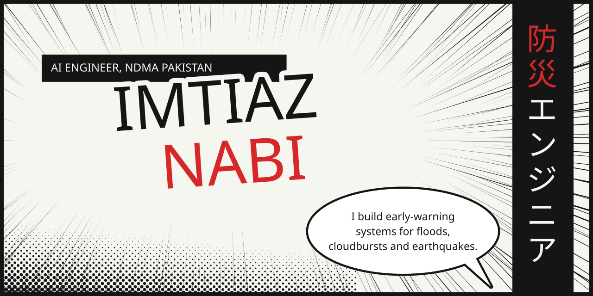
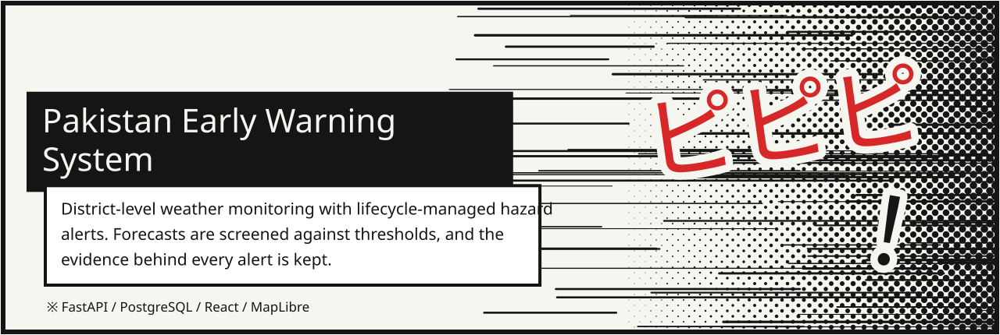
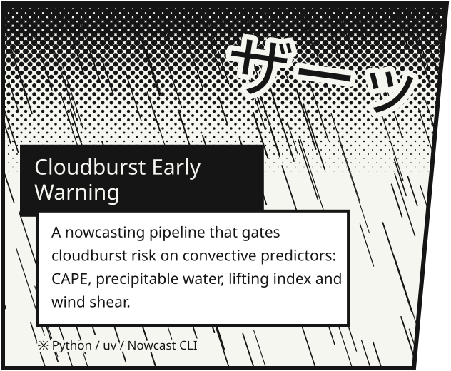
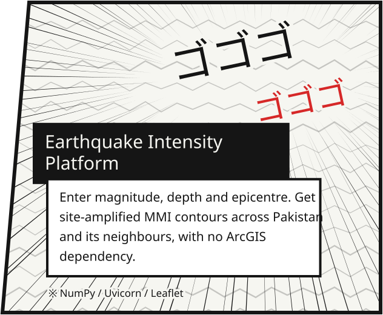
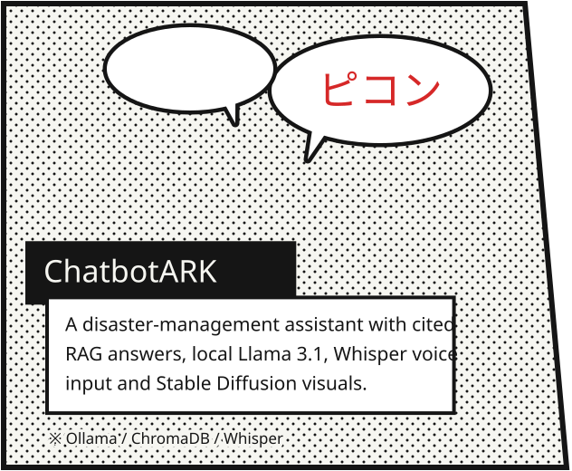
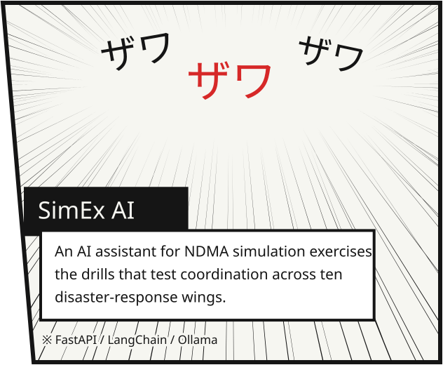
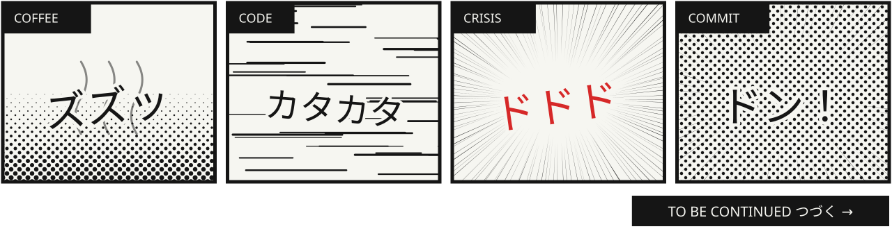

 

I work at the **National Disaster Management Authority (NDMA), Pakistan**, where machine learning, agentic AI and geospatial analytics meet. My systems turn Earth observation, climate and sensor feeds into decision support for disaster risk reduction and resilience planning, using models that learn, reason and act on their own.

 

<h3></h3>

 

<h3></h3>

<table>
  <tr>
    <td width="50%" valign="top"><b>Agentic AI systems</b> LLM agents for real-time analysis, decision support and automation.</td>
    <td width="50%" valign="top"><b>Earth observation AI</b> Deep learning on Sentinel, CHIRPS and CMIP6 with Google Earth Engine.</td>
  </tr>
  <tr>
    <td valign="top"><b>Early warning dashboards</b> Real-time monitoring for floods, heatwaves and droughts.</td>
    <td valign="top"><b>Retrieval-augmented generation</b> Context-aware knowledge systems that ground answers in structured data.</td>
  </tr>
  <tr>
    <td valign="top"><b>Generative models</b> GANs and diffusion models for data synthesis and enhancement.</td>
    <td valign="top"><b>Model engineering</b> End-to-end PyTorch and TensorFlow workflows, from preprocessing to deployment.</td>
  </tr>
</table>

 

<h3></h3>

**LLM and agents** &nbsp; LangChain, LlamaIndex, Ollama, Hugging Face, MLflow 
**Geospatial** &nbsp; Google Earth Engine, Rasterio, xarray, geemap, Cartopy 
**Data and apps** &nbsp; NumPy, Pandas, Plotly Dash, Streamlit, Gradio, Power BI

 

<h3></h3>

- Building **agentic AI systems** that monitor, reason about and respond to environmental hazards.
- Researching **GANs for satellite data simulation** and **diffusion models** for hazard visualisation.
- Developing **LLM decision-support agents** for humanitarian operations.
- Exploring **multi-modal AI** that joins vision, text and geospatial data.

 

<h3></h3>

I like working on AI tools, geospatial intelligence and climate tech. If you are applying AI, LLMs or ML for the public good, I would like to hear about it.

&nbsp;
&nbsp;
&nbsp;

  

Off the clock: video games and manga.

