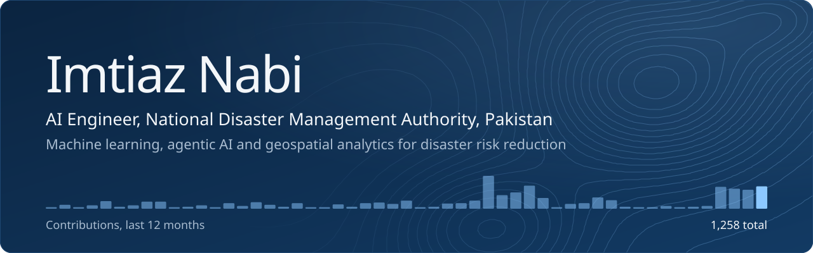
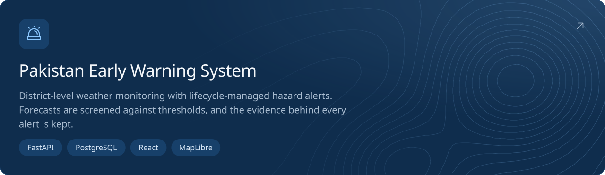
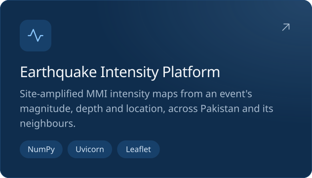
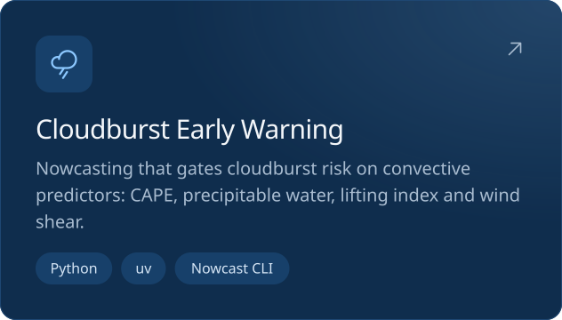
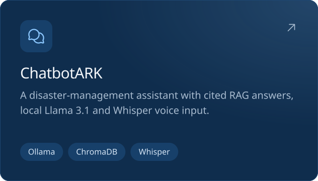
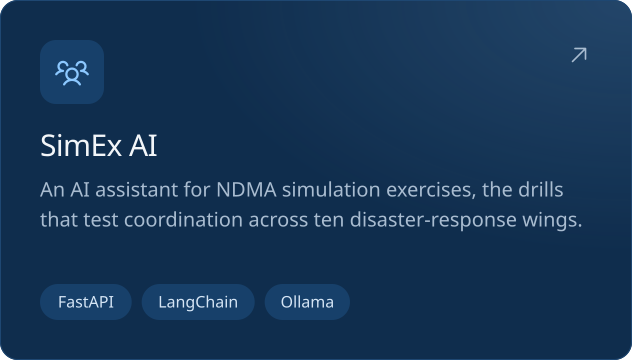

I build AI systems for disaster risk reduction at the **National Disaster Management Authority (NDMA), Pakistan**. My work turns Earth observation, climate and sensor data into early warnings and decision support, using machine learning, agentic AI and geospatial analytics.

### Selected work

### What I work on

<table>
  <tr>
    <td width="33%" valign="top"> <b>Agentic AI systems</b> LLM agents for real-time analysis, decision support and automation.</td>
    <td width="33%" valign="top"> <b>Earth observation</b> Deep learning on Sentinel, CHIRPS and CMIP6 data with Google Earth Engine.</td>
    <td width="33%" valign="top"> <b>Early warning</b> Monitoring and alerting for floods, cloudbursts, heatwaves and droughts.</td>
  </tr>
  <tr>
    <td valign="top"> <b>Retrieval-augmented generation</b> Knowledge systems that ground answers in documents and structured data.</td>
    <td valign="top"> <b>Generative models</b> GANs for satellite data simulation and diffusion models for hazard visualisation.</td>
    <td valign="top"> <b>Model engineering</b> End-to-end PyTorch and TensorFlow workflows, from preprocessing to deployment.</td>
  </tr>
</table>

### Toolkit

**LLMs and agents:** LangChain, LlamaIndex, Ollama, Hugging Face, MLflow 
**Geospatial:** Google Earth Engine, Rasterio, xarray, geemap, Cartopy 
**Data and apps:** NumPy, Pandas, Plotly Dash, Streamlit, Gradio, Power BI

### Get in touch

I'm interested in collaborating on AI for the public good, geospatial intelligence and climate tech.

&nbsp;
&nbsp;
&nbsp;

 

Outside work: video games and manga.
